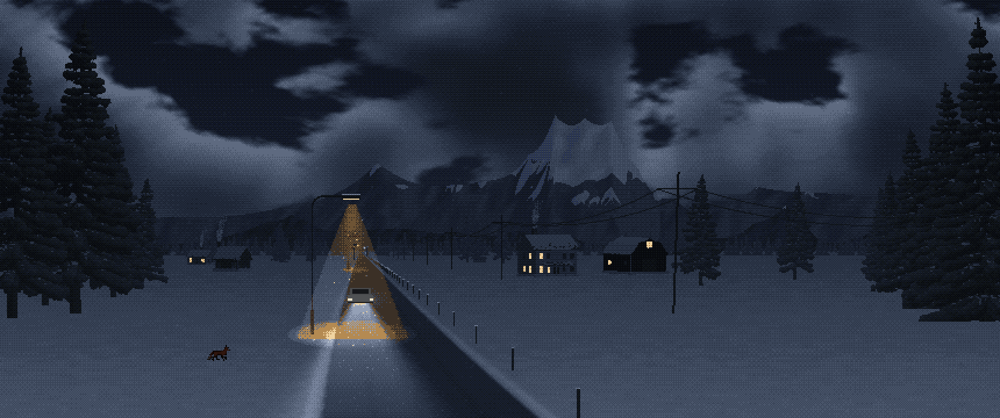

# KDE Plasma bits by Aestylis

Procedural, GPU-rendered wallpapers for KDE Plasma 6. Each folder is a standalone Plasma package.

| | |
|---|---|
| [**Silent County Road**](silent-county-road/) | A quiet pixel-art winter road that follows the real time of day, with a tiny snowplough that clears it every morning. Includes a Sky scene for a second monitor. |
| [**Hexgrid (Ember)**](hexgrid-wallpaper/) | An animated black/grey/orange hex grid whose tiles drift in colour and swap places. |



## Install

```
git clone https://github.com/Aestylis/kde
kpackagetool6 -t Plasma/Wallpaper -i kde/silent-county-road
kpackagetool6 -t Plasma/Wallpaper -i kde/hexgrid-wallpaper
```

Then choose the wallpaper under *Desktop and Wallpaper → Wallpaper type*. Use `-u` instead of `-i` to upgrade.

## Licence

MIT © Aestylis
