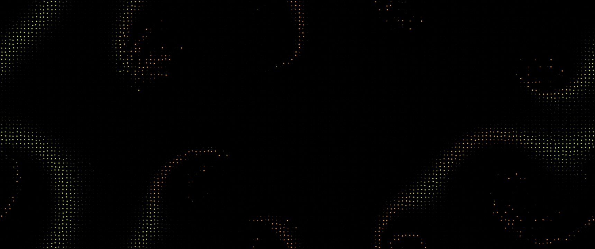

# Chimera

An animated wallpaper for KDE Plasma 6, made for OLED screens. A field of dots that flash like fireflies. Every
dot keeps its own rhythm but is nudged by the average rhythm of its neighbourhood. Parts of the field fall into
unison and send waves and spirals of light across the screen, while other parts never settle. That split, order and
disorder side by side in a field of identical oscillators, is called a chimera state.



A dot's colour shows how well it agrees with its neighbours: one colour where the neighbourhood pulses together,
another where it does not. Only a few percent of the screen is lit at any moment; the rest is true black.

## Settings

- **Colours**: Firefly, Deep sea, Ultraviolet, Ember, Moonlight.
- **Dot spacing** and **dot size**.
- **Seconds per flash**: how fast the whole thing runs.
- **Disorder**: low gives broad waves and a few spirals, high gives islands of chaos in a sea of unison. It can
  drift over time so the field keeps changing character.
- **Neighbourhood reach**: how far each dot listens. Larger makes broader structures.
- **Brightness** and **frame rate** (12 to 24).

## Install

```
kpackagetool6 -t Plasma/Wallpaper -i chimera-wallpaper
```

Then choose *Chimera* under *Desktop and Wallpaper → Wallpaper type*. Use `-u` instead of `-i` to upgrade.

## How it works

The simulation is the Kuramoto–Sakaguchi model with non-local coupling and runs entirely on the GPU, in textures
with one texel per dot. `step.frag` advances every dot's phase by its own pace plus a pull towards its
neighbourhood's average rhythm, taken with a phase lag; the lag is what keeps part of the field from ever
synchronising. `blur.frag` (run across, then down) produces that neighbourhood average. `show.frag` draws the dots.
After editing a shader run `./build.sh` (needs `qsb` from qt6-qtshadertools).

MIT © Aestylis
