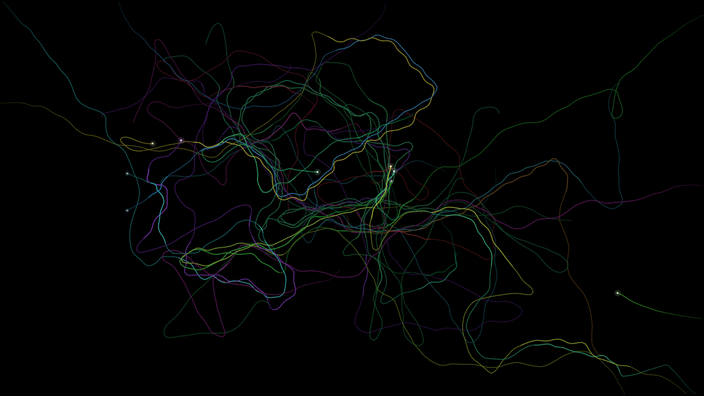

# Lifelines

An animated wallpaper for KDE Plasma 6. An answer, in moving lines, to "what is it to be human".

Every life is a thread of light. It begins thin, wanders, and is always on its way somewhere. If it meets another
it may fall in beside it; two threads that walk together shine brighter, weave around each other and come to want
the same destination. After a while a new thread may begin between them, coloured a little like both. Most
companions part again. Every thread ends. What stays is its trace, which fades slowly, and the living lean towards
ground that has been walked before, so over hours the screen becomes a map of where lives have gone, with roads
nobody planned and families you can tell apart by colour.



Things to look for: a bright pair travelling together; a ring closing where a life begins and opening where one
ends; a lone dim thread arriving from the edge when the world has grown quiet; a colour that was not there an hour
ago.

## Settings

- **Most lives at once**, how long **a long life** lasts, and **walking pace**.
- How long **traces** take to fade, **thread width** and **trace brightness**.
- **Open with a time-lapse of the past**: the first 24 seconds run thirty times faster, so the screen does not
  start empty.

## Install

```
kpackagetool6 -t Plasma/Wallpaper -i lifelines-wallpaper
```

Then choose *Lifelines* under *Desktop and Wallpaper → Wallpaper type*. Use `-u` instead of `-i` to upgrade.

## How it works

A few dozen walkers are stepped eight times a second in JavaScript (`contents/ui/main.qml`): each steers by its
own drifting whim, its destination, the nearest other life in sight, and a coarse memory of how worn the ground
ahead is. Their newest stretch of path is stroked onto a texture that feeds back into itself and is dimmed a touch
each step (`contents/shaders/fade.frag`), the same trail technique as Meander. Nothing is redrawn between steps.
After editing the shader run `./build.sh` (needs `qsb` from qt6-qtshadertools).

MIT © Aestylis
