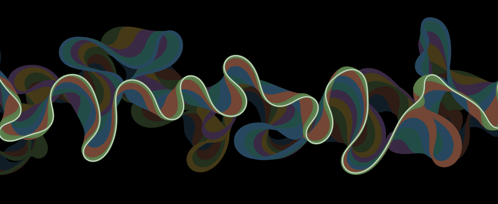

# Meander

An animated wallpaper for KDE Plasma 6. A river wanders across a black screen: bends grow, lean downstream,
tighten and finally cut themselves off into oxbow lakes. Every old course stays behind as a slowly fading coloured
band, the way survey maps chart a river's past. It never repeats, and it moves slowly enough that the thing to
notice is how different it looks an hour later.



## Settings

- **Colours**: Survey map, Neon, Ember, Glacier, Ultraviolet. The colour changes every minute or so, which is what
  turns the river's sweep into distinct bands.
- **River size**, **Speed**, how long **old courses** take to fade, and the brightness of the old courses and of
  the river itself.

## Install

```
kpackagetool6 -t Plasma/Wallpaper -i meander-wallpaper
```

Then choose *Meander* under *Desktop and Wallpaper → Wallpaper type*. Use `-u` instead of `-i` to upgrade.
It takes a few seconds after login to appear while the river's recent past is worked out.

## How it works

`contents/ui/sim.js` runs in a worker thread and moves the river's centreline eight times a second. Each point
moves sideways at a rate set by the channel's curvature there and, with an exponential weight, the curvature
upstream (Howard & Knutson 1984, the model behind Zoltán Sylvester's meanderpy). Where two reaches touch, the loop
between them is cut off. A river needs tens of thousands of steps to mature, so a mature one is baked into the file
(`node tools/bake.js`) and each start takes a random stretch of it.

The old courses live in a texture that feeds back into itself: each step it is dimmed a touch
(`contents/shaders/fade.frag`) and the current channel is stroked onto it. Nothing is redrawn between steps, so
the wallpaper costs very little. After editing the shader run `./build.sh` (needs `qsb` from qt6-qtshadertools).

MIT © Aestylis
