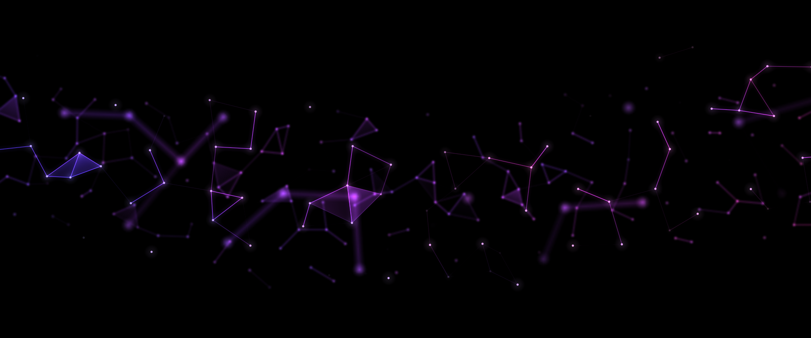
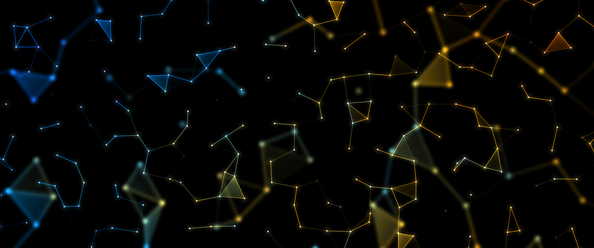

# Plexus

An animated geometric wallpaper for KDE Plasma 6, made for OLED screens. Dots wander slowly; when two come close a
line joins them, and three linked dots may fill in as a translucent triangle. A few depth layers sit in front of and
behind the sharp one and are drawn out of focus. The background is true black, so unlit pixels stay off.




## Settings

- **Colours**: ten default combinations, or pick your own three or four. *Colour scatter* goes from a smooth
  gradient across the screen to every dot choosing its own colour.
- **Dots and lines**: number of dots, dot size, link distance, line width and brightness.
- **Triangles**: how many fill in, and how opaque they get.
- **Motion and layout**: speed; drifting clusters, a wave across the screen, or the whole screen; coverage;
  *Continue across monitors*.
- **Depth and light**: 1 to 4 depth layers, blur, glow, brightness, rendering (balanced or sharp), frame rate
  (12 to 24).

## Several monitors

With *Continue across monitors* on (the default), every monitor shows its part of one desktop-wide pattern: lines
and triangles carry on across the screen edges and the colours run over the whole desktop. Each monitor has its own
wallpaper settings in Plasma, so set Plexus on each one and give them the same values. The copies stay in step
because the animation follows the wall clock.

*Monitor arrangement* decides how the screens are placed in that pattern: as they are laid out in Display
settings, or stacked top to bottom and centred, for desks where the monitors sit above each other but one of them
is off to the side in the logical layout.

*Rendering: Balanced* draws scaled (HiDPI) screens at their logical resolution, which costs roughly half as much
on a 4K screen at 150–200 % scale. *Sharp* draws every pixel.

## Install

```
kpackagetool6 -t Plasma/Wallpaper -i plexus-wallpaper
```

Then choose *Plexus* under *Desktop and Wallpaper → Wallpaper type*. Use `-u` instead of `-i` to upgrade.

## How it works

Two fragment shaders, no geometry and no blur pass. The plane is a grid of cells with one dot each.
`contents/shaders/cells.frag` works out every dot's position, presence and colour once per cell into a small float
texture; `contents/shaders/plexus.frag` then draws each pixel by reading the few dots near it. The blurred layers
are softened analytically and rendered at reduced resolution. All motion is a whole multiple of one loop phase
taken from the wall clock, so it runs for weeks without drifting and all monitors stay in step. After editing a
shader run `./build.sh` (needs `qsb` from qt6-qtshadertools).

MIT © Aestylis
