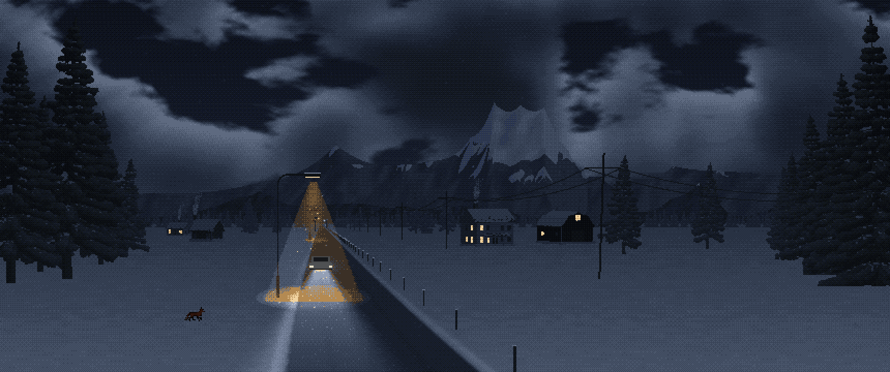
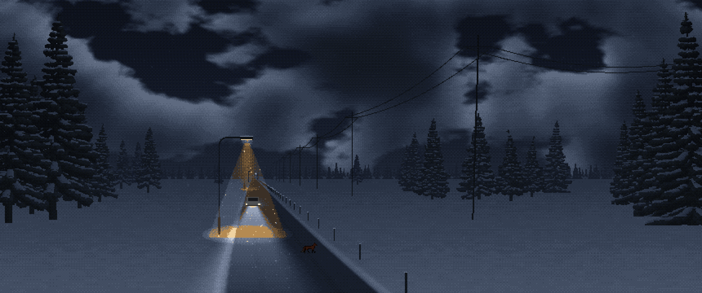
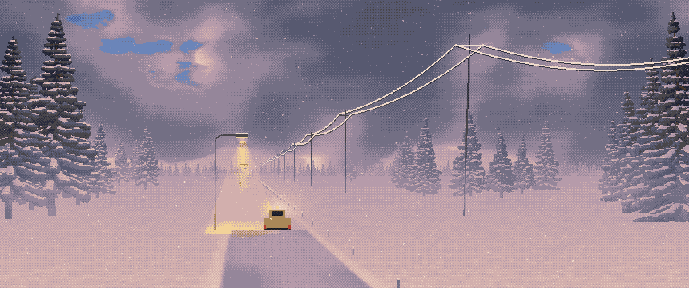
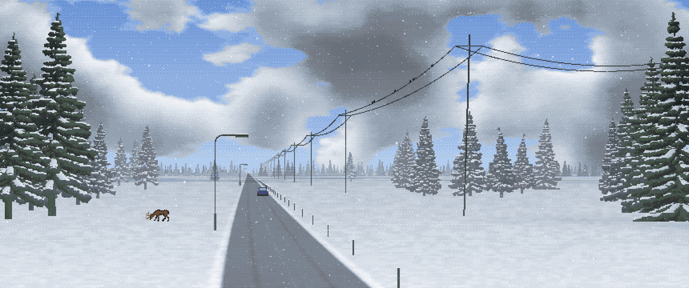
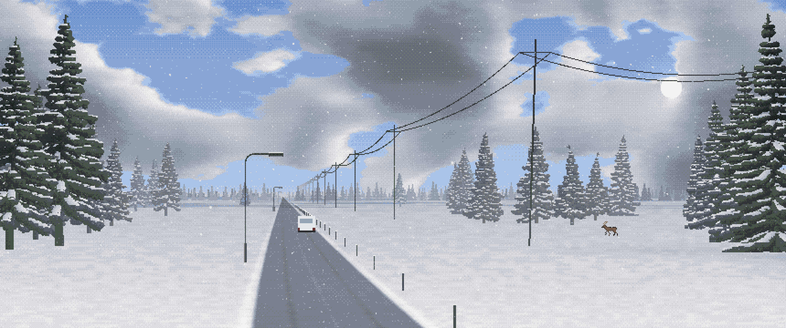
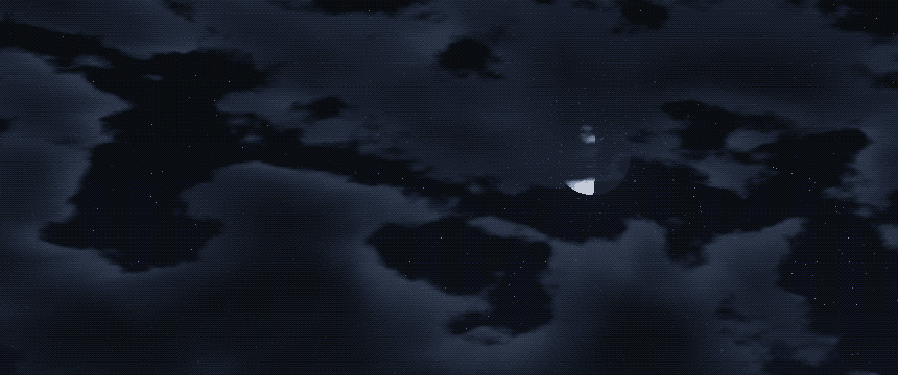
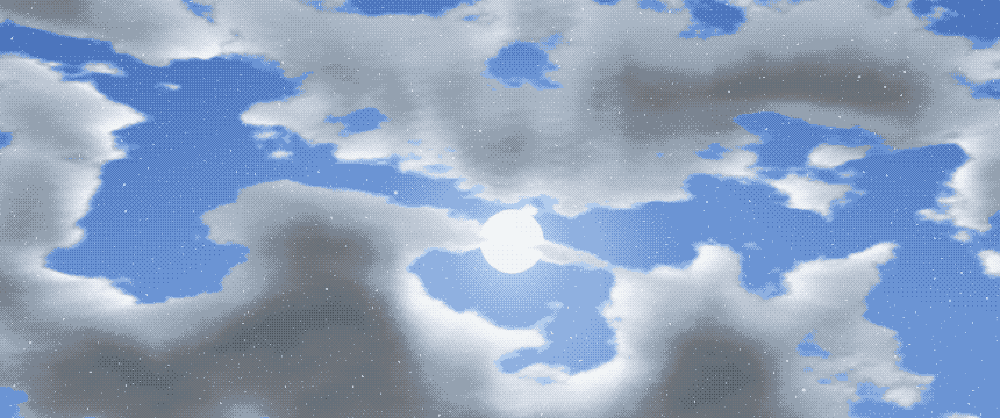

# Silent County Road

A quiet pixel-art winter road for KDE Plasma 6 that follows the real time of day, with a tiny snowplough that clears
it every morning. Fully procedural: one GPU fragment shader, no images.








- Three depth layers of spruces with atmospheric perspective (distance fades toward the sky) and sun-facing lighting
- Spruces grown procedurally in 3D (whorls of drooping branches, side sprays, snow on the boughs, dead lower twigs, broken tops), baked to a relightable pixel-art atlas by `tools/gen_trees.py` and lit live by the sun, the moon and the lamps
- Cloud shadows drifting across the snowfield, the road and the trees on sunny days
- Clouds lit by the real sun or moon: sunlit tops, dark undersides, golden edges at sunset
- Real sunrise / sunset / sun position for your latitude and longitude; hand-picked palettes for night, dawn, day, dusk
- Snow in three depth layers, mostly visible in the lamplight at night; patchy, drifting snowfall and wind moods
- Occasional traffic in both directions: headlights or tail lights at night, tyre tracks that fill back in
- Snow builds on the power lines overnight and falls off in clumps through the late morning
- A deer wanders through by day (stopping to graze); a fox by night; traffic stops for them if they cross. Animal sprites are CC0, "Animated Wild Animals" by ScratchIO (see contents/images/CREDITS.md)
- By day, flocks of birds land on the wire for a few minutes, then fly off
- Streetlamps off by day, stuttering on at dusk, occasionally flickering (the far one is dying)
- Snow builds on the road overnight; ~25 min after sunrise a plough with an amber beacon clears it
  (or press **Send the plough** in the settings)
- **Scene: Sky** for a monitor above: the real moon phase behind snow clouds at night, the sun crossing by day;
  both screens share one clock
- ~1–3 % of one CPU core




## Install

From Plasma: *Desktop and Wallpaper → Get New Plugins…* and search for **Silent County Road**.

From source:

```
git clone https://github.com/Aestylis/kde
kpackagetool6 -t Plasma/Wallpaper -i kde/silent-county-road      # upgrade later with -u
```

Then pick **Silent County Road** under *Desktop and Wallpaper → Wallpaper type*.

## Settings

Scene (road / sky), pixel size, frame rate, snow, fog, wind, lamp flicker, winter mode (follows the day / always
clear / always buried), latitude and longitude, preview any hour, Send the plough and Send wildlife.

## Building

`./build.sh` recompiles the shaders (needs `qt6-qtshadertools` for `qsb`) and writes the store archive to `dist/`.
The shaders use an integer hash, so they target desktop OpenGL / Vulkan (GLSL 150/330), not GLES.

## Licence

MIT © Aestylis
